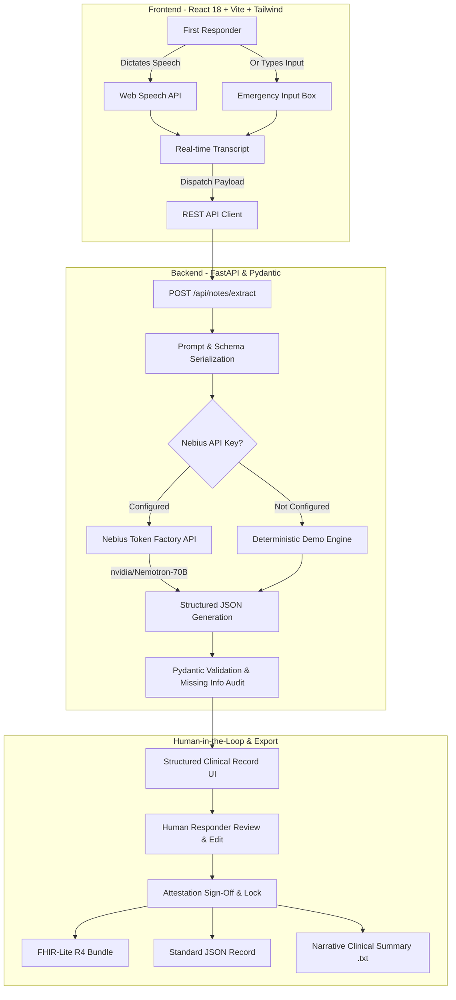

# FieldScribe Edge — Voice-to-Structured Clinical Note Generator
### Built for the Nebius x NVIDIA Global AI Hackathon 2026

[](LICENSE)
[](https://studio.nebius.ai/)
[](https://build.nvidia.com/)
[](https://hl7.org/fhir/)

---

## 🚑 1. Executive Summary & Problem Statement

First responders, paramedics, and emergency medical technicians (EMTs) operate in chaotic, high-pressure environments where every second counts. During cardiac arrests, severe trauma, anaphylaxis, or overdose emergencies, responders administer high-potency medications, perform rapid interventions, and constantly reassess vitals.

However, clinical documentation often lags:
- **High Cognitive Load:** Writing notes by hand or typing on clunky laptops while navigating traffic or patient transport is difficult and hazardous.
- **Lost Context & Omissions:** Critical variables—such as exact administration timestamps, medication routes (IV vs. IM vs. sublingual), and vital reassessments—are easily forgotten or omitted.
- **Handoff Delays:** Transferring care to the emergency department triage team requires a clear, standardized summary. Incomplete handoffs lead to redundant testing, delayed interventions, or dangerous medication errors.
- **AI Hallucination Hazards:** Conventional large language models frequently invent medical dosages, infer unstated routes, or fabricate diagnoses—an unacceptable danger in clinical care.

### The Solution: FieldScribe Edge
**FieldScribe Edge** is an AI-powered voice-to-structured clinical documentation assistant that allows first responders to speak or type natural-language notes and instantly converts them into validated, reviewable, timestamped clinical records.

> **Crucial Safety Principle:** FieldScribe Edge is an objective **documentation assistant**, never a diagnostic or treatment recommendation system. It enforces a strict **Zero-Hallucination Fidelity Guard**: if an attribute was not explicitly spoken or typed, the AI flags it as missing rather than inventing data. All records require human review and verification before export.

---

## ⚡ 2. Nebius & NVIDIA Integration

FieldScribe Edge is purpose-built to harness the high-throughput inference of **Nebius Token Factory** paired with **NVIDIA open-source foundation models**:

| Component | Specification | Detail |
|---|---|---|
| **AI Inference Cloud** | **Nebius Token Factory** | OpenAI-compatible high-throughput inference endpoint (`https://api.studio.nebius.ai/v1`) delivering sub-second token latency. |
| **Primary Open Model** | **`nvidia/Llama-3.1-Nemotron-70B-Instruct-HF`** | NVIDIA's flagship 70B parameter instruction model, engineered for high-precision structured JSON output and complex domain reasoning. |
| **Alternative Eligible Models** | `meta-llama/Meta-Llama-3.1-70B-Instruct`, `nvidia/Nemotron-4-340B-Instruct` | Easily configurable via `NEBIUS_MODEL` in `.env`. |
| **Validation Layer** | **Pydantic v2 & Fidelity Guard** | Server-side schema interception ensuring all medication, dosage, route, and procedure entities strictly exist in the source note. |
| **Zero-Key Local Engine** | **Deterministic Safety Engine** | Enables immediate out-of-the-box local hackathon evaluation even prior to configuring a cloud API key. |

---

## 🏗️ 3. Architecture & Data Flow



---

## 🚀 4. Technology Stack

- **Frontend:**
  - React 18 with TypeScript
  - Vite for instant hot-module replacement
  - Tailwind CSS (Dark navy `#070b18` and cyan `#06b6d4` emergency theme)
  - Framer Motion & Lucide React icons
  - React Router v6
  - Browser Web Speech API (`webkitSpeechRecognition`) with typed fallback
- **Backend:**
  - Python 3.11+
  - FastAPI (High-performance asynchronous REST API)
  - Pydantic v2 (Strict data models and payload validation)
  - Uvicorn (ASGI production server)
  - HTTPX (Asynchronous HTTP client for Nebius Token Factory)
  - In-Memory & JSON file persistence (`backend/data/records.json`)

---

## 📦 5. Step-by-Step Installation & Run Guide

### Prerequisites
- Node.js v18+ and npm
- Python 3.10+
- (Optional) Nebius Token Factory API key from [Nebius Studio](https://studio.nebius.ai/)

### Step 1: Clone the Repository
```bash
git clone https://github.com/your-username/fieldscribe-edge.git
cd fieldscribe-edge
```

### Step 2: Set Up Backend
```bash
cd backend

# Create Python virtual environment
python -m venv venv

# Activate virtual environment
# Windows (PowerShell):
.\venv\Scripts\Activate.ps1
# Linux / macOS:
source venv/bin/activate

# Install dependencies
pip install -r requirements.txt

# Configure environment variables
cp .env.example .env
```

#### Configure `.env`:
Open `backend/.env` in your text editor:
```env
# Optional: Enter your Nebius Token Factory API key for live Cloud AI
NEBIUS_API_KEY=your_actual_nebius_api_key_here
NEBIUS_BASE_URL=https://api.studio.nebius.ai/v1
NEBIUS_MODEL=nvidia/Llama-3.1-Nemotron-70B-Instruct-HF
HOST=127.0.0.1
PORT=8000
```
> *Note:* If `NEBIUS_API_KEY` is left blank, FieldScribe Edge operates in verified **Local Demo Engine** mode so judges can evaluate the complete end-to-end workflow immediately without external credentials!

#### Start the FastAPI Server:
```bash
python -m uvicorn app.main:app --host 127.0.0.1 --port 8000 --reload
```
Backend API will be live at: `http://127.0.0.1:8000`  
Interactive Swagger docs: `http://127.0.0.1:8000/docs`

---

### Step 3: Set Up Frontend
Open a new terminal window:
```bash
cd frontend

# Install dependencies
npm install

# Start Vite dev server
npm run dev
```
Frontend application will be accessible at: `http://localhost:5173`

---

## 🩺 6. The 2-Minute Hackathon Demo Workflow

1. **Launch Landing Page (`http://localhost:5173`):**  
   Review the problem statement, workflow architecture, and Nebius/NVIDIA live engine pill. Click **"Create Clinical Note"**.
2. **Input Emergency Note:**  
   Click the **Microphone** icon to test the browser Web Speech API, or click the **1-Click Demo Scenario**:
   > *"Patient found conscious after a fall. First responder administered 500 milligrams of a fictional demo medication named DemoMed by oral route at 10:15 AM. A basic wound dressing procedure was performed at 10:20 AM. Patient was reassessed at 10:30 AM."*
3. **Trigger AI Extraction:**  
   Click **"Generate Structured Note"**. Watch the animated multi-stage processing modal as the note is processed by the NVIDIA Nemotron model via Nebius.
4. **Human Review & Missing Information Flags:**  
   View the generated record (`/records/FS-DEMO-001`):
   - Medication table extracts `DemoMed`, `500 milligrams`, `oral`, `10:15 AM`.
   - Procedure table extracts `basic wound dressing`, `10:20 AM`.
   - Missing info card flags: *"No secondary vital signs (BP, SpO2) recorded in verbatim note"*.
5. **Edit & Attest:**  
   Edit or add a field, input responder attestation notes: *"Verified dosages against dispatch radio log."*
6. **Confirm & Export:**  
   Click **"Confirm & Lock Record"** to lock the audit trail. Click **"Export"** to preview:
   - **FHIR-Lite:** Standardized HL7 FHIR Bundle with `Composition`, `MedicationAdministration`, `Procedure`, and `Observation`.
   - **Narrative Note:** Clean, human-readable summary for emergency department handoff.
   - **JSON:** Complete validated schema payload.

---

## 📡 7. API Reference

| Method | Endpoint | Description |
|---|---|---|
| `GET` | `/` | Service health and hackathon metadata |
| `GET` | `/health` | Live backend and Nebius AI engine status (safe, no exposed secrets) |
| `POST` | `/api/notes/extract` | Accepts note text, executes Nebius NVIDIA extraction, returns validated Pydantic JSON |
| `GET` | `/api/records` | Lists all demo records with search (`?search=...`) and status filter (`?status=...`) |
| `GET` | `/api/records/{id}` | Fetches single record by ID |
| `POST` | `/api/records` | Creates a new draft clinical record |
| `PATCH` | `/api/records/{id}` | Updates record fields during human review |
| `POST` | `/api/records/{id}/confirm` | Attests and locks record as verified |
| `GET` | `/api/records/{id}/export` | Exports record in `?format=json`, `?format=fhir`, or `?format=narrative` |

---

## 📋 8. Hackathon Submission Materials

### Project Title
**FieldScribe Edge — Voice-to-Structured Clinical Note Generator**

### Short Description
A real-time, voice-enabled emergency clinical documentation assistant that transforms spoken or typed first-responder notes into structured, FHIR-ready medical records with zero-hallucination guardrails and mandatory human review, powered by Nebius Token Factory and NVIDIA Nemotron.

### Problem Statement
Emergency responders make rapid, lifesaving decisions under extreme stress. Vital details like medication dosages, routes, and procedure timestamps are frequently documented on fragmented scraps of paper or delayed until hours after patient handover. Existing LLM solutions risk hallucinating medical facts, creating unacceptable patient safety risks.

### Solution & Technical Innovation
FieldScribe Edge introduces an edge-first documentation workflow:
1. Responders dictate in noisy field conditions via Web Speech API or typed fallback.
2. The note is ingested by Nebius Token Factory utilizing the **NVIDIA Nemotron-70B-Instruct** open-source foundation model.
3. The system enforces a strict zero-hallucination rule: unstated routes or dosages are flagged as missing documentation rather than inferred.
4. Responders review, edit, and attest the record before generating standard FHIR-lite R4 bundles or clinical narrative summaries.

### NVIDIA & Nebius Integration
- **Nebius Token Factory:** Provides low-latency, enterprise-grade cloud inference at `https://api.studio.nebius.ai/v1`.
- **NVIDIA Open Model:** Uses `nvidia/Llama-3.1-Nemotron-70B-Instruct-HF` for precise clinical entity extraction, entity linkage, and timestamp attribution.

### Impact & Safety
- **Saves 8-15 minutes** of post-incident documentation per run.
- **Eliminates handoff ambiguity** when transferring trauma patients to emergency department doctors.
- **Ensures clinical safety** through mandatory human-in-the-loop attestation and transparent missing-field alerts.

### 2-Minute Video Recording Outline
1. **0:00 - 0:25:** *Intro & Problem:* Show landing page, explain documentation delays and risks in emergency medical response.
2. **0:25 - 0:55:** *Voice Capture & AI Extraction:* Click "Create Note", use microphone or load the demo trauma note, show live Web Speech transcript, click "Generate Structured Note" with Nebius Token Factory processing.
3. **0:55 - 1:30:** *Human Review & Missing Info:* Inspect extracted medication and procedure cards, show highlighted missing vitals alert, demonstrate editing a field and adding responder attestation.
4. **1:30 - 1:55:** *FHIR-Lite & Narrative Export:* Open export modal, toggle between Standard JSON, FHIR R4 Bundle, and Narrative Note (.txt).
5. **1:55 - 2:00:** *Conclusion:* Highlight NVIDIA open-source model precision and Nebius high-speed cloud infrastructure.

---

## 🛡️ 9. Limitations & Safety Disclaimer

- **Prototype for Hackathon Evaluation:** FieldScribe Edge is an AI documentation prototype developed specifically for the Nebius x NVIDIA Global AI Hackathon 2026.
- **Fictional Data Only:** All bundled sample records are fictional and do not depict real patients.
- **Documentation Only:** This application is strictly an administrative documentation assistant and does not provide clinical diagnosis, clinical decision support, or treatment recommendations.
- **Not HIPAA Certified:** This MVP does not claim HIPAA, GDPR, or SaMD certification and is not intended for live patient medical interchange.

---

## 📄 10. License

This project is open-source under the [MIT License](LICENSE).

